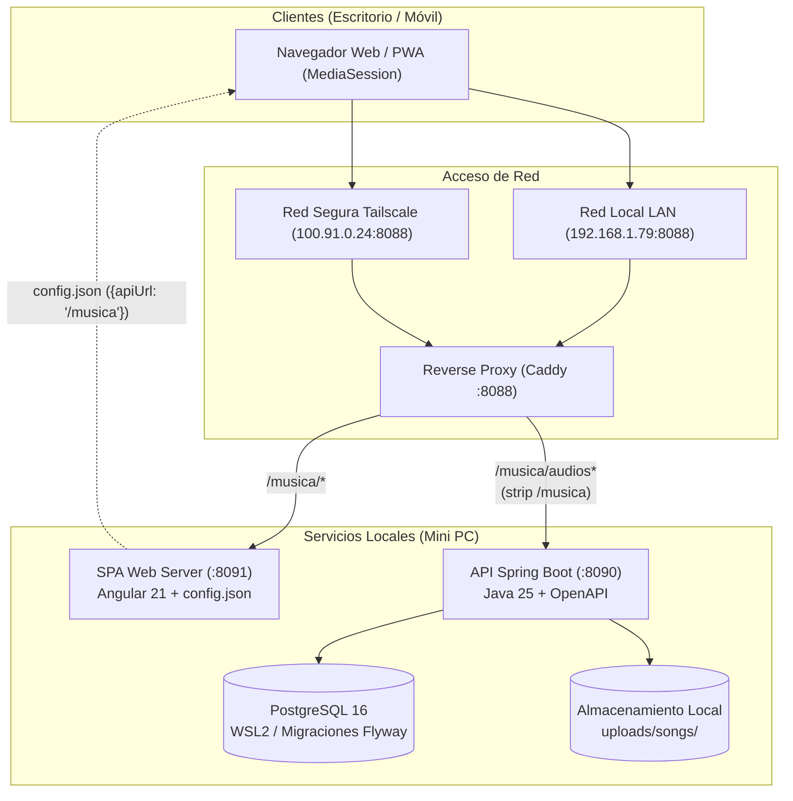

# 🎵 Audio Streaming

[](./RELEASE.md)
[](https://github.com/B3RT1C/audio-streaming-backend)
[](https://github.com/B3RT1C/audio-streaming-web)
[](https://github.com/B3RT1C/audio-streaming-backend)
[-orange?style=flat-square)](https://github.com/B3RT1C/audio-streaming)

> **Repositorio general del ecosistema de streaming de audio.**  
> Contiene la documentación técnica central, arquitectura, hoja de ruta y especificaciones. El código de la aplicación se distribuye en repositorios dedicados para backend y frontend.

---

## 🏛️ Repositorios del Ecosistema

El proyecto está desacoplado sin paquetes compartidos; la **API HTTP REST y el contrato OpenAPI** actúan como única fuente de verdad:

| Repositorio | Rol / Tecnología | Enlace |
| :--- | :--- | :--- |
| **`audio-streaming-backend`** | API central REST, streaming con Range (206), persistencia y OpenAPI | [Ver repositorio →](https://github.com/B3RT1C/audio-streaming-backend) |
| **`audio-streaming-web`** | Cliente web SPA estilo Spotify, PWA, Media Session y gestión de biblioteca | [Ver repositorio →](https://github.com/B3RT1C/audio-streaming-web) |
| **`audio-streaming`** | *(Este repo)* Documentación de arquitectura, versionado y roadmap | [Ver repositorio →](https://github.com/B3RT1C/audio-streaming) |

---

## 📐 Arquitectura del Sistema



---

## 📊 Alcance y Estado por Versión

| Versión | Estado | Novedades principales |
| :---: | :---: | :--- |
| **v0.1.0** | Completado | Base inicial de subida de ficheros, stream básico y listado. |
| **v0.2.0** | Completado | Metadatos de biblioteca (artista, álbum), playlists y reproductor web. |
| **v0.3.0** | Completado | Título secundario, artistas múltiples, etiquetas libres y autocompletado. |
| **v0.4.0** | Completado | Etiquetas tipadas (`tag_types`), filtros combinados AND (`f`), orden aleatorio determinista (`seed`). |
| **v0.5.0** *(Actual)* | **En producción** | Eventos de escucha (`play_events`), estadísticas históricas y timeline (`/stats/*`), stream HTTP con cabecera Range (códigos 206/416), integración bajo subpath `/musica/` con Caddy. |
| **v1.0.0** | En diseño | Cliente desktop con sincronización offline local. |

---

## 📚 Documentación Técnica

- **[Arquitectura](./arquitectura.md):** Fundamentos de diseño del backend, frontend y decisiones de desacoplamiento.
- **[Contrato de API OpenAPI](https://github.com/B3RT1C/audio-streaming-backend/blob/main/docs/openapi.yaml):** Especificación OpenAPI 3.0 vigente.
- **[Estrategia de Versionado](./VERSIONING.md):** Convenciones de versionado de producto, tags de git, artefactos Maven, npm y migraciones Flyway.
- **[Notas de Versión](./RELEASE.md):** Detalle histórico de releases y cambios por versión.
- **[Hoja de Ruta (Roadmap)](./roadmap.md):** Próximos pasos hacia la versión 1.0.0.
- **[Histórico CI/CD Jenkins](./jenkins-ci-cd.md):** Diseño anterior del pipeline de integración continua.

---

## 💻 Entorno de Desarrollo Local

Para trabajar en el ecosistema se recomienda organizar los repositorios en una misma carpeta:

```bash
mkdir audio-streaming-ws && cd audio-streaming-ws
git clone https://github.com/B3RT1C/audio-streaming.git
git clone https://github.com/B3RT1C/audio-streaming-backend.git
git clone https://github.com/B3RT1C/audio-streaming-web.git
```

### 1. Backend (Spring Boot + Java 25)
Requiere PostgreSQL en ejecución (por defecto `localhost:5432`, DB `music-streaming-db`, usuario/clave `postgres`):

```bash
cd audio-streaming-backend
./mvnw spring-boot:run
```
*API escuchando en `http://localhost:8080`.*

### 2. Frontend Web (Angular 21)
```bash
cd audio-streaming-web
npm install
npm start
```
*Aplicación disponible en `http://localhost:4200`.*

---

## 🏠 Despliegue en Servidor Doméstico (Mini PC)

En el entorno de producción doméstico:
- **Proxy inverso:** Caddy escucha en el puerto central `8088`.
- **Ruta Web:** `http://<IP>:8088/musica/` enlazada a `127.0.0.1:8091`.
- **Ruta API:** `http://<IP>:8088/musica/audios` dirigida a `127.0.0.1:8090`.
- **Configuración dinámica:** `config.json` en el cliente establece `{"apiUrl": "/musica"}` para que todo el tráfico quede aislado y no colisione con otros servicios del host.
