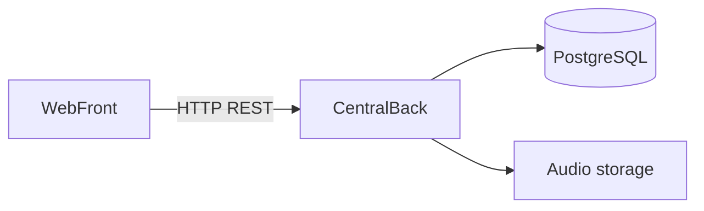

# Arquitectura

Documento del repo general [`audio-streaming`](https://github.com/B3RT1C/audio-streaming).

## Alcance v0.2.0

Solo **back central + cliente web**. No hay desktop, mobile ni mini-back local en esta versión. No hay login: el servicio se usa dentro de la red privada (Tailscale o LAN).

El contrato HTTP (fuente de verdad) está en el backend:

[docs/openapi.yaml](https://github.com/B3RT1C/audio-streaming-backend/blob/main/docs/openapi.yaml)

No hay paquete shared.

## Responsabilidades (v0.2.0)

- **Back central**: catálogo, metadata (etiquetas con jaudiotagger), almacenamiento, playlists e importación de una carpeta. Esquema Postgres vía **Flyway** (sin wipe de datos de usuario); migraciones `V{seq}__app_{x}_{y}_{z}_…`. En 0.2.0: `V2__app_0_2_0_library_metadata_and_playlists.sql`. Hibernate usa `ddl-auto=validate`.
- **Front web**: UI, búsqueda, playlists y reproducción. `PlaybackResolver` arma la URL de stream. El origen de la API sale de `config.json` (`apiUrl`); si viene vacío, el mismo host en el puerto 8080.

Formatos de audio: `mp3`, `m4a`, `aac`, `flac`, `wav`, `ogg`, `opus`, `webm`.

## Contrato

- `GET /audios?q=` — `q` opcional
- `GET /audios/{id}` con HTTP Range (**206** / **416**)
- `POST /audios` (multipart; `name` opcional)
- `PATCH /audios/{id}` — metadata
- `DELETE /audios/{id}` — también quita la pista de las playlists
- CRUD de `/playlists`
- `POST` y `DELETE /playlists/{id}/items`, `PUT /playlists/{id}/items` con `{ "audioIds" }` para reordenar
- `POST /admin/import` — `{ "path" }` opcional; salta duplicados por ruta original o por hash
- Errores: `{ message, code }` (ver OpenAPI)

`GET /sync/status` sigue escrito en el OpenAPI y no tiene controlador. La sincronización es posterior (ver roadmap).

## Más adelante

Desktop, mobile, mini-back local y sync quedan fuera de v0.2.0. Plan: [roadmap.md](./roadmap.md) (`1.0` = desktop + sync). Notas actuales: [RELEASE.md](./RELEASE.md).
